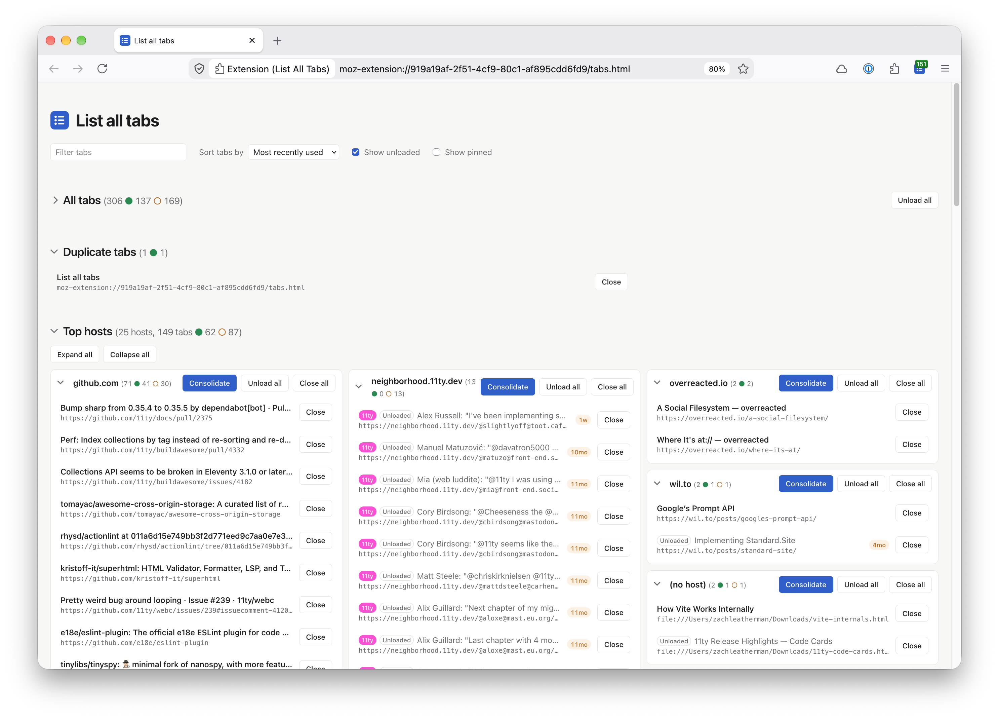

I am a habitual tab hoarder so I created a Firefox addon to help me manage every one of my very special browser tabs.

Sort tabs by oldest, unload them, find duplicates, and consolidate tabs to a single window — buncha useful stuff in there!

* [Download from Mozilla Addons](https://addons.mozilla.org/en-US/firefox/addon/list-all-tabs-updated/)
* [Source code on GitHub](https://github.com/zachleat/list-all-tabs)

## Features

- Go directly to a tab by clicking on it.
- Shows Duplicate tabs open more than once.
- Supports Multi-account containers for a tab (and the color of the container too)
- Filter tabs by title, URL or container name.
- Sort tabs by tab order, least recently used or most recently used.
- You can unload tabs to free memory, either one at a time or with “Unload all” for all tabs or by host (YouTube tabs especially).
- _Show unloaded_ and _Show pinned_ toggles.
- _Consolidate_ moves all of a host’s tabs into a new window.
- _Expand all_ and _Collapse all_ for the Top hosts list.
- Tabs you haven’t used for a week or more show a stale time difference (e.g. `2w` or `3mo`).
- Light and dark modes.
- Pinned tabs are listed last (and are not operable).
- `about:blank` tabs are ignored.