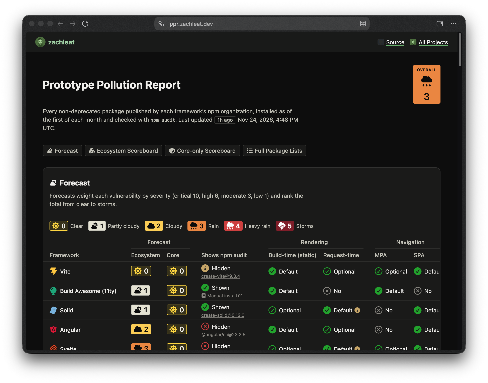

## Meaningful Audits are Important

Look at these two `npm audit` outputs generated this morning and tell me which project is more secure:

```sh
$ npm audit
# uh… 521 lines of vulnerability reports truncated
78 vulnerabilities (7 low, 23 moderate, 46 high, 2 critical)
```

```sh
$ npm audit
found 0 vulnerabilities
```

Which project is more secure? The one with 0 vulnerabilities, right? _Not necessarily!_

The former was created from a fresh `create-gatsby` command to make a Gatsby project. The latter was created from a fresh `create-next-app` to create a Next.js project (defaults selected for both).

_Spicy take incoming:_ both Next.js and Gatsby have similarly _egregious_ security footprints but Next sweeps their vulnerability reports under the rug.

## Dependency Hide and Seek

`next` (`v16.4.6` at time of writing) bypasses `node_modules` entirely for its own dependencies (I first [wrote about this in 2023](/web/site-generator-review/)). If you look inside `node_modules/next/dist/compiled` you’ll see 139 unique dependencies that (when audited) report 11 low, 2 moderate, 19 high, and 3 critical vulerabilities otherwise _unreported_ by standard audit report mechanisms.

Gatsby is no longer maintained so it was surprising to see more critical **(hidden)** vulnerabilities in Next.js than critical **(visible)** vulnerabilities in Gatsby.

This practice of bundling dependencies isn’t exclusive to Next.js: Vite repeats an arguably similar practice in `node_modules/vite/dist` though with bundler-generated output. It’s a bit easier to excuse this practice as a local developer tool and not a production runtime but (in my personal opinion) it seems like an overcorrection to opt-out dependencies from audits entirely.

(It should also be noted that Vite has a _very good record_ of keeping its bundled dependencies up-to-date and audit-free.)

Transparency and insight are the most important pieces of security auditing mechanisms and doing an `npm audit` when using these tools misses in-use dependencies.

## Behind the Curtain

Another common practice (though _less_ egregious) to sweep audits under the rug is to have your **`create-` CLI package** install dependencies for you and conveniently hide audit output from the install step. This practice is less egregious because it won’t _hide_ dependencies in-use from a `npm audit` command run in the project independently, though I would argue that it isn’t sufficiently transparent.

- `create-gatsby` uses `npm install --no-audit`
- `create-astro`, TanStack CLI, and `create-preact` don’t show console output
- `create-nuxt` and `ng new` (Angular) print console output only when install fails
- `sv create` (Svelte) shows momentarily but clears the log post-install

Your **package manager** might take an opinionated stance here too. While `npm ` shows audit reports after an `npm install` command, both pnpm and yarn do not!

## Prototype Pollution Report

I wanted a report that normalized away these issues to compare different framework ecosystems and you can see the output of that at the cheekily named [Prototype Pollution Report](https://ppr.zachleat.dev/).

[](https://ppr.zachleat.dev/)

It updates about once a day and will show how different ecosystems measure over time.

- The Ecosystem Scoreboard measures _all_ non-deprecated packages published from various projects and takes a bit of an opinionated stance: maintainers need to deprecate packages they no longer maintain!
- The Core-only Scoreboard measures _only_ the core package, which I felt like was interesting enough to have standalone.
- Full package lists (with audit counts) are shown at the end.